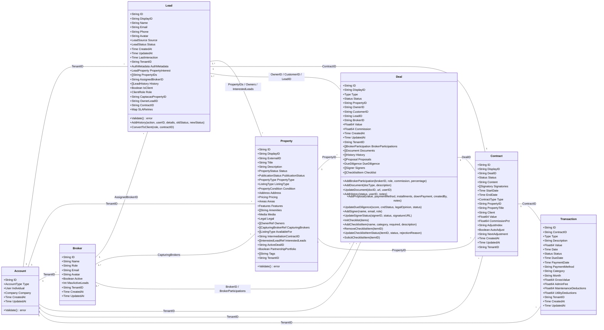

# Diagrama de Entidades e Relacionamentos (UML Detalhado)

Este diagrama representa a estrutura exata do backend em Go (models dos microsserviços), refletindo as propriedades e os métodos conforme definidos no código-fonte.

