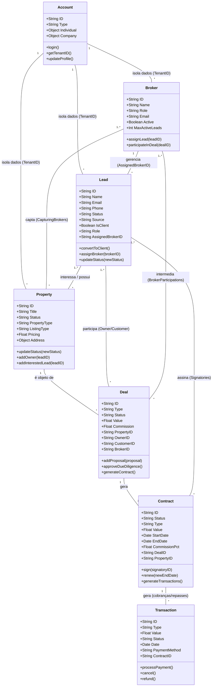

# Diagrama de Entidades e Relacionamentos (UML)

Este diagrama ilustra as principais entidades da aplicação, suas propriedades, métodos e os relacionamentos entre elas.
Você pode visualizar este diagrama usando uma extensão de visualização de Markdown/Mermaid no seu editor, ou colando o código abaixo no [Mermaid Live Editor](https://mermaid.live/).

