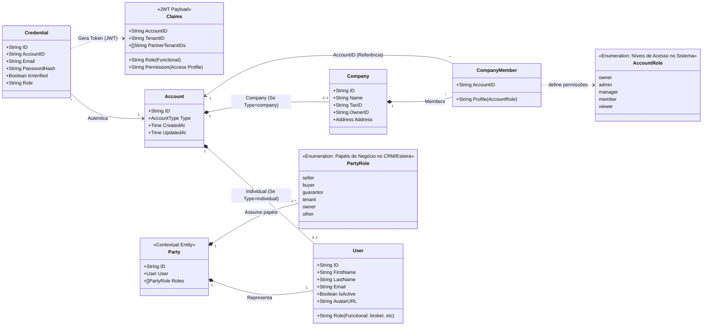

# Diagrama de IAM, Permissões e Padrão Party/Role

Este diagrama detalha o ecossistema de Contas (Accounts), Usuários (Users), Autenticação (Credentials/Claims), Regras de Permissão de Acesso (Account Roles) e o Padrão de Projeto Party/Role (usado para mapear dinamicamente os papéis de negócio dos usuários no sistema).

